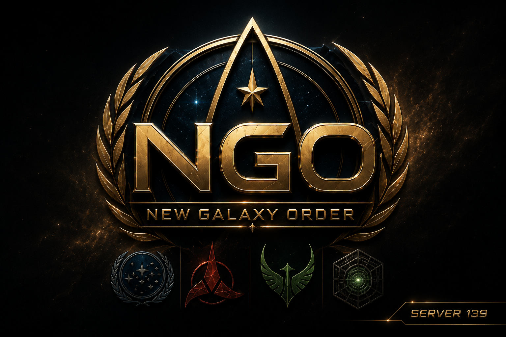

# STFC Community Mod

  

A community mod for the desktop version of **Star Trek Fleet Command** on Windows and macOS.
It adds adjustable UI scaling, camera controls, keyboard shortcuts, cargo previews, and data sync.

## NGO Build — New Galaxy Order

Star Trek Fleet Command — NGO Custom Build

Customized for New Galaxy Order (NGO) — Server 139

This repository contains a custom NGO build based on the excellent
STFC Community Mod.

The original Community Mod and its core functionality are developed and maintained by the STFC Community Mod contributors.
This fork adds NGO-specific branding, graphics and personal customizations while continuing to track and integrate updates from the upstream project.

✨ NGO Customizations  
🖖 New Galaxy Order (NGO) branding  
🌌 Custom Star Trek Fleet Command graphics and loading screens  
🛰️ Server 139 themed assets  
🔄 Regular synchronization with the latest STFC Community Mod dev branch  

NGO — New Galaxy Order
Server 139

Built upon the STFC Community Mod

---

## Start here

| You want to | Read |
| --- | --- |
| Install or update the mod | [Install the mod](docs/INSTALL.md) |
| Change a setting | [Settings and file locations](docs/INSTALL.md#change-settings) |
| Find or change a shortcut | [Keyboard shortcuts](docs/KEYMAPPING.md) |
| See what the mod can do | [Features](docs/FEATURES.md) |
| Build or contribute code | [Contributing](CONTRIBUTING.md) |
| Example configuration files | [Example settings](docs/EXAMPLE_SETTINGS.md) |

Download the [latest release](https://github.com/STFC-Mod/mod/releases/latest/).

For test builds, use the [release list](https://github.com/STFC-Mod/mod/releases/).

If a game update breaks the mod, check **#info** in the
[STFC Community Mod Discord](https://discord.gg/PrpHgs7Vjs) for hotfixes.

## Get help

- Use the [Discord server](https://discord.gg/PrpHgs7Vjs) for support.

- Include your operating system, game version, mod version, and the relevant lines from `community_patch.log`.

- The [installation guide](docs/INSTALL.md#fix-installation-problems) covers common problems.

## Project details

The project accepts [code contributions](CONTRIBUTING.md) and
[sponsorship](https://github.com/sponsors/netniV).

See the [changelog](CHANGELOG.md) for recorded releases.

The mod uses the [GPLv3 license](LICENSE). [Third-party notices](docs/THIRD_PARTY.md) and
[Windows DLL verification](docs/WINDOWS_DLL_PROVENANCE.md) have their own references.
There is no account-safety guarantee for features added outside this repository.
